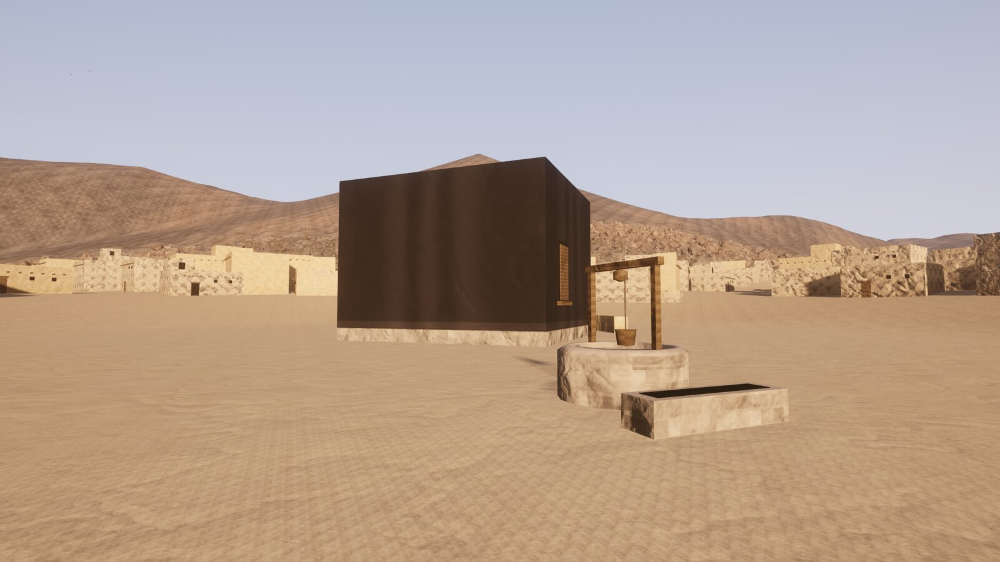
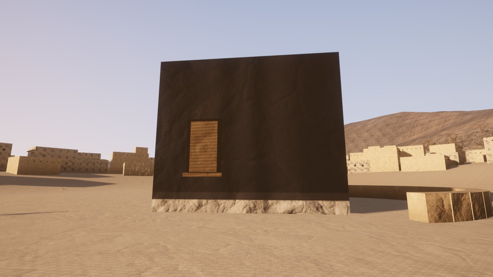
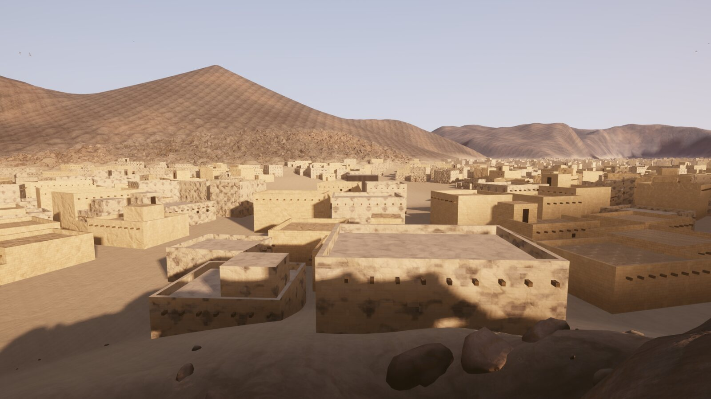
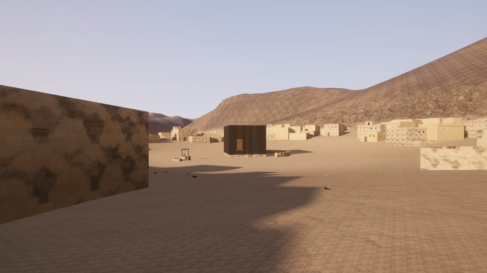
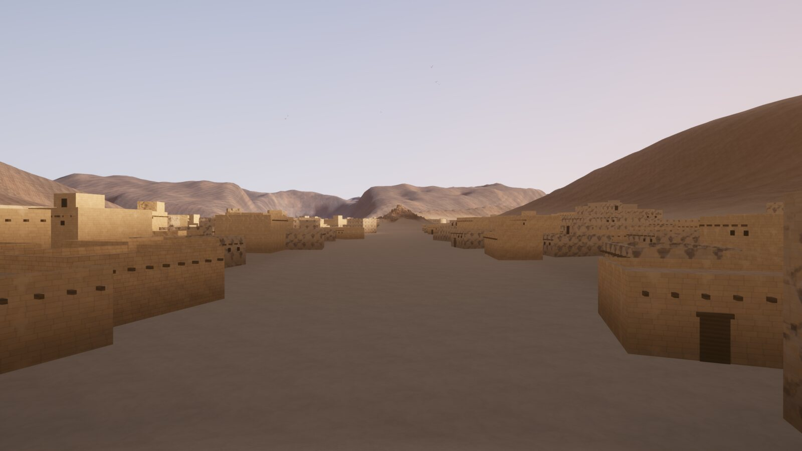
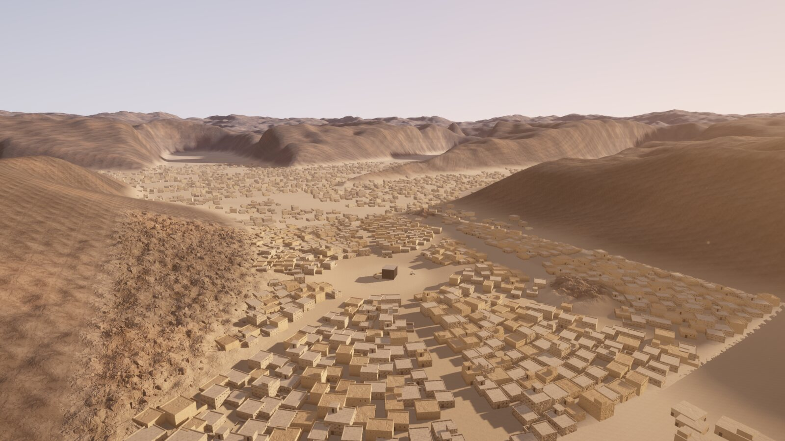
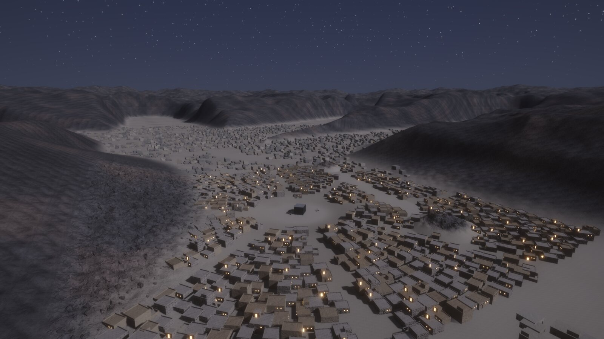

# Makkah, First Years

<p align="center">
  <a href="https://moeymakes.github.io/makkah-first-years/"></a>
</p>
<p align="center"><b><a href="https://moeymakes.github.io/makkah-first-years/">moeymakes.github.io/makkah-first-years/</a></b><br>
<sub>Chrome or Edge on a desktop or laptop (needs WebGPU) · nothing to install · one HTML file</sub></p>

**Walk through the valley of Makkah as it may have looked around 630-632 CE, after the conquest, right in your browser.**

**This is an artistic reconstruction, not an exact one.** What is reasonably known (the Kaaba as rebuilt by Quraysh,
shorter on the side of the Hijr, with its door raised above the ground; the open ground around it with no mosque
yet; the well of Zamzam nearby; the low hills of Safa and Marwa; a town of stone and mud-brick houses between bare
mountains) is drawn as faithfully as the sources allow, and every detail they do not settle is an informed guess,
listed in [`NOTES.md`](NOTES.md). The geography is compressed so it fits in one walk. There are no people in the
scene, no interiors, no writing anywhere, and nothing is recited.

Everything is made by code: no images, no 3D models, no sound files. The whole world is **one HTML file** of
about 90 KB.

[](https://moeymakes.github.io/makkah-first-years/)

| | |
|---|---|
|  |  |
|  |  |





## Try it

1. Open **[https://moeymakes.github.io/makkah-first-years/](https://moeymakes.github.io/makkah-first-years/)** in **Chrome** or **Edge** on a desktop computer, or download
   [`index.html`](index.html) and open it from your computer (it works offline).
2. Wait a few seconds while the valley is built, then press **Enter** and start walking.

It needs a browser with **WebGPU**.

## What's there

- **The Kaaba** in an open sandy space: plain dark cloth over a base course of stone, the wooden door raised high
  on the north-east face, a water spout on the roof edge, and a low curved wall around the Hijr
- **Zamzam**: a simple stone well with a wooden frame, a rope and bucket, and a stone trough
- **Safa and Marwa**: two low rocky rises with the open way between them
- **The town**: houses of rough granite and of mud brick, flat roofs with parapets and roof timbers, small high
  windows, a few walled yards, lanes leading to the open space, thinning out up the slopes
- **The mountains** around the valley, Abu Qubays over the Kaaba to the east, and Jabal al-Nour far to the north-east
- **Time**: **Dawn**, **Golden hour** or **Night** in the menu (remembered; the page reloads). At night there is only
  moonlight, the stars and a few warm lamp and fire glows in doorways
- **Sound** made up as you listen: wind down the valley, small birds and rock doves in the morning. Nothing recited

## Controls

| | Keyboard & mouse |
|---|---|
| Look around | Move the mouse (or drag with the left button where the mouse cannot be captured) |
| Walk | `W` `A` `S` `D` |
| Run | Hold `Shift` |
| Fly / walk | `F`, or `E` to lift off from walking |
| Up / down | `E` / `Q` (descending onto the ground lands you back to walking) |
| Jump to a viewpoint | `1` to `6` |
| Menu | `Esc` |
| Sound on / off | `M` |
| Sound mix | **Valley**, **Wind**, **Birds**, **Calm** or **Off** in the menu, plus a volume slider (remembered next visit) |
| Time of day | **Dawn**, **Golden hour** or **Night** in the menu (reloads the page) |
| Performance stats | `H` |
| Detail level | **Low**, **Medium** or **High** in the menu (reloads the page) |

**On a touchscreen:** hold one finger down to walk forward and slide it to look around; a second finger runs;
the ✈ button toggles flight.

## How it works

- The ground model (the valleys, the mountains, Safa and Marwa, the open ground and where the houses stand) is one
  function evaluated on the graphics card when the page opens: at 1 m around the Kaaba, 2 m over the 2 km around
  it and about 23 m over 24 km of surroundings.
- The ground near the Kaaba is a 3D density field turned into a mesh, so the rocks of Safa and Marwa can overhang.
- The houses are built from boxes when the page opens; the far town is thousands of instanced houses.
- The far landscape is a ring-shaped mesh out to 12 km with soft baked shadows; the long shadows of the mountains
  reach the town through a baked "lit height".
- Everything is drawn with **WebGPU** directly. No engine or 3D library.
- The method, the verification loop and the page structure follow
  [Abyssal Garden](https://github.com/noniv/abyssal-garden) (MIT), via the `worldsmith` skill.

## Make it your own

Source is in [`source`](source). Rebuild with Node.js 18+:

```bash
cd source && npm install && npm run build
```

| File | What's inside |
|---|---|
| [`source/src/world.js`](source/src/world.js) | Layout: the Kaaba, Zamzam, the houses and lanes, rocks, trees, viewpoints and the camera path |
| [`source/src/shaders.js`](source/src/shaders.js) | The ground model, sky and haze, stone, mud brick, cloth, lamps, stars and the final image |
| [`source/src/main.js`](source/src/main.js) | Renderer, walking and flying, collision, controls |
| [`source/src/audio.js`](source/src/audio.js) | The soundscape |
| [`source/src/quality.js`](source/src/quality.js) | Detail levels and the three times of day |
| [`source/template.html`](source/template.html) | The page: loading bar, menu, controls list |

`npm run build:dev` writes `dev.html` with a scripted one-minute flight (`P`) and a benchmark (`B`).

## Other worlds in this series

- **[Jabal al-Nour](https://moeymakes.github.io/makkah-jabal-al-nour/)**: the stepped path up the mountain to the Cave of Hira, Makkah far below today ([source](https://github.com/moeymakes/makkah-jabal-al-nour))
- **[Madinah, First Years](https://moeymakes.github.io/madinah-first-years/)**: the oasis and the first mosque around 622-632 CE, an artistic reconstruction ([source](https://github.com/moeymakes/madinah-first-years))
- **[Madinah Horizon](https://moeymakes.github.io/madinah-horizon/)**: the date gardens, lava fields and hills around Madinah at golden hour ([source](https://github.com/moeymakes/madinah-horizon))
- **[Nabawi Courtyard](https://moeymakes.github.io/masjid-nabawi-courtyard/)**: the marble plaza of the Prophet's Mosque up close ([source](https://github.com/moeymakes/masjid-nabawi-courtyard))

## License

MIT. Parts adapted from Abyssal Garden (MIT); its notice is in `source/LICENSE-abyssal-garden`.
